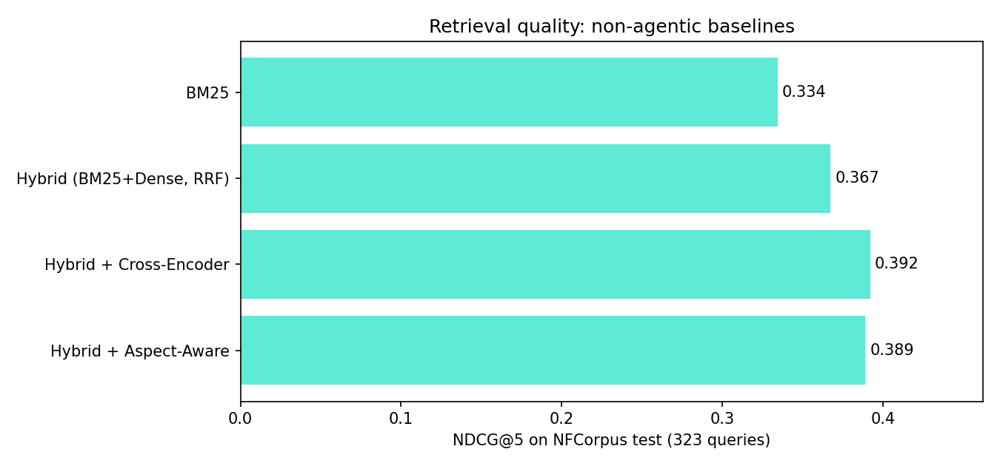
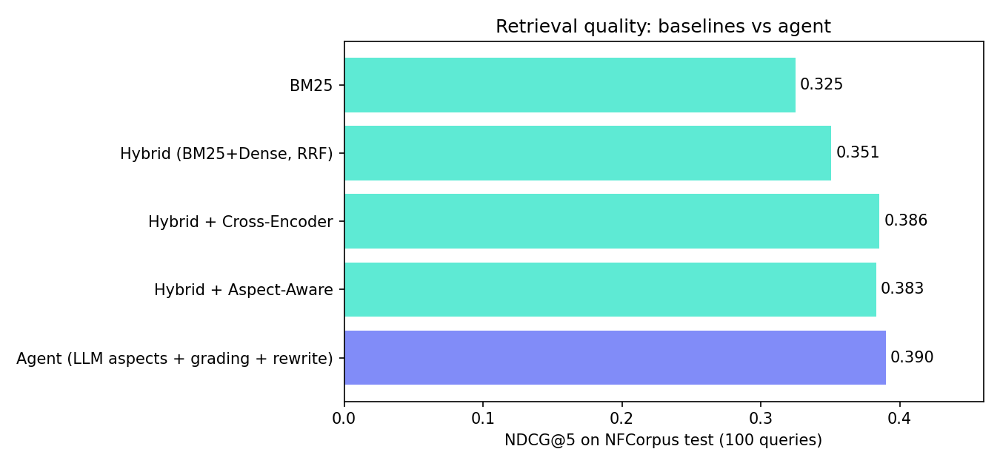

# Agentic RAG for medical research

A **LangGraph agent** that answers medical and nutrition questions from 3,633 research abstracts (NFCorpus). It plans its searches, judges which documents are relevant, rewrites the query when the evidence is thin, answers with inline citations, and then **verifies** each sentence against the sources. It runs behind a **FastAPI** service with a small web demo and is packaged with **Docker**.

It extends my earlier study, [aspect-aware-rag-reranking](https://github.com/Sathrish/aspect-aware-rag-reranking), whose retrieval code is reused unchanged. The question this repo asks is not "can I build an agent?" but **"does the agent actually retrieve and answer better than a simpler pipeline, and what does it cost?"**

## How the agent works

```
question ─► plan ─┬─► (greeting / off-topic) ─────────────► direct reply
                  └─► retrieve ─► grade ─┬─ enough evidence ─► answer ─► verify ─► response
                        ▲                └─ thin evidence ─► rewrite ─┘ (bounded: 1 extra round)
                        └──────────────────────────────────────────────┘
```

| Step | What it does |
|---|---|
| **plan** | LLM routes the question (retrieve vs direct reply) and splits it into 1–4 *aspects*, e.g. "statins breast cancer risk", "statins breast cancer survival". Falls back to a rule-based splitter if the LLM fails. |
| **retrieve** | Hybrid search: BM25 + dense MiniLM embeddings (FAISS), fused with Reciprocal Rank Fusion, then **aspect-aware re-ranking** (cross-encoder relevance balanced against covering new aspects). Never re-shows a document already graded. |
| **grade** | LLM marks which retrieved documents actually help. The agent then measures **aspect coverage**: the share of aspects covered by the relevant evidence. |
| **rewrite** | If fewer than 2 relevant documents or under 50% coverage, the LLM writes a new query aimed at the *missing* aspects. Capped at one extra round. |
| **answer** | LLM answers from the evidence only, citing `[n]` after each claim, and says so when the sources don't cover something. |
| **verify** | A second LLM pass checks each sentence against its cited sources and reports a **faithfulness** score plus the unsupported sentences. |

The UI shows every step (the agent trace), the sources, and the metrics for each answer.

## Results

### Retrieval baselines (all 323 NFCorpus test queries, human relevance labels)



| System | NDCG@5 | MRR |
|---|---|---|
| BM25 | 0.3344 | 0.500 |
| Hybrid (BM25 + dense, RRF) | 0.3673 | 0.538 |
| Hybrid + cross-encoder | **0.3919** | **0.567** |
| Hybrid + aspect-aware | 0.3889 | 0.560 |

- **Reproducibility check:** BM25 scores exactly 0.3344, the same as my original study, so the reused code behaves identically.
- **Hybrid fusion helps:** +9.9% NDCG@5 over BM25 (paired randomisation test, 10,000 resamples, p < 0.001).
- **Aspect-aware re-ranking does not beat the cross-encoder here:** −0.8% NDCG@5 (p = 0.03). Its purpose is covering more aspects of a question, which NDCG does not reward, so the agent uses it for evidence coverage and this repo reports the trade-off rather than hiding it.

### Agent vs baselines

**Retrieval** on 100 fixed random test queries (seed 42), same models and data for every system:



| System | NDCG@5 | MRR |
|---|---|---|
| BM25 | 0.325 | 0.459 |
| Hybrid (BM25 + dense, RRF) | 0.351 | 0.518 |
| Hybrid + cross-encoder | 0.386 | 0.524 |
| Hybrid + aspect-aware | 0.383 | 0.517 |
| **Agent** (LLM aspects + grading + rewrite) | **0.390** | **0.537** |

**Answers** on the 15 reference questions, agent vs single-pass RAG (same retriever, same LLM, same answer prompt):

| | ROUGE-L | Faithfulness (verifier) | Citation rate | LLM calls | Tokens | Seconds |
|---|---|---|---|---|---|---|
| Single-pass RAG | 0.124 | 88.6% | 64.8% | 2.0 | 2,860 | 7.3 |
| Agent | 0.123 | **92.3%** | 57.3% | 4.1 | 3,682 | 15.9 |

What this shows, honestly:
- **The agent has the best retrieval scores, but the margin is not significant.** +1.2% NDCG@5 over the cross-encoder (paired randomisation test, p = 0.74). With 100 queries, this benchmark cannot separate the top three systems.
- **Its answers were more faithful to the sources** (92% vs 89% of sentences verified), again **not significant** on only 15 questions (p = 0.42). ROUGE-L against the reference answers is unchanged.
- **It costs about 2x**: 4.1 LLM calls instead of 2, and 16 s instead of 7 s per answer. 46% of queries needed a query rewrite.
- **A bug found by per-query analysis.** The first run scored the agent *below* the baselines (0.367). Looking per query rather than at the average showed the planner had refused to search 15 keyword-style queries ("Hiroshima", "bagels"), treating them as off-topic. Search is now skipped only for chit-chat, enforced in code with a regression test, and the agent moved from last to first. The pre-fix results are kept in `results/retrieval_agent_100_before_planner_fix.csv`.

Conclusion: on this corpus the agent is **at least as good as the strongest pipeline and somewhat more faithful, at twice the cost**. A larger question set would be needed to show a significant difference.

## Engineering notes and problems I hit

- **Provider-agnostic LLM layer.** Any OpenAI-compatible API works through three environment variables. The default is Groq's free tier with `openai/gpt-oss-120b`.
- **Free-tier limits shaped the design.** Groq's free tier allows 1,000 requests and 200,000 tokens per model per day. My first benchmark run hit the daily token cap after 100 queries and, because results were only saved at the end, lost them. The evaluation now **saves after every query and resumes** where it stopped. Setting `reasoning_effort=low` for gpt-oss cut hidden reasoning tokens by about 20x (225 → 11 on a grading call). The API also rate-limits each client to protect the shared demo quota.
- **Retired model.** My first default model had been retired by the provider; the code now lists available models instead of assuming.
- **Citation format.** gpt-oss cites with `【3】` rather than `[3]`, which made the citation counter report zero. Answers are normalised before scoring.
- **Truncation was hiding conclusions.** Feeding the first 700 characters of each abstract cut off the conclusion, so the agent wrongly called the statin survival evidence "uncertain". It now sends each abstract's opening **and** ending.
- **Dataset download.** The original BEIR server intermittently fails Python's TLS verification, so the loader falls back to the identical Hugging Face mirror (verified: 3,633 documents, 323 test queries).
- **Trusting the LLM's routing was a bug.** The planner prompt said "direct reply for off-topic questions", and the model applied it to short keyword queries. The rule is now enforced in code (`is_chitchat`), not left to the prompt.
- **Robustness.** If the planner, grader or verifier returns bad JSON, the agent degrades gracefully (rule-based aspects, keep all documents, skip verification) and records it in the trace rather than failing the request.
- **Fitting a 512 MB free server.** The PyTorch stack needs well over 1 GB. For deployment the same two models run through ONNX (fastembed), and I profiled memory step by step: the cross-encoder's memory pool grew by about 240 MB per call with batches of 20 long abstracts, so it now scores one document at a time on one thread (flat memory, about 1.3 s per rerank). The `rank_bm25` index stored a Python dict per document (65 MB), so `lean_bm25.py` re-implements the same formula with NumPy posting lists; it produces identical top-20 rankings on all 323 test queries (checked by a test). Document embeddings ship pre-computed in `assets/`. The running service now peaks at about 485 MB.

## Run it

```bash
python -m venv .venv && .venv\Scripts\activate        # Windows (use source .venv/bin/activate elsewhere)
pip install torch --index-url https://download.pytorch.org/whl/cpu
pip install -r requirements.txt
copy .env.example .env                                # then paste a free key from https://console.groq.com/keys
python -m ragagent.prepare                            # downloads NFCorpus + models, caches embeddings
uvicorn ragagent.api:app --port 7860                  # open http://localhost:7860
```

Tests use fake models and a fake LLM, so they run offline with no API key:

```bash
python -m pytest -q          # 22 tests: search, lean BM25, agent routing, rewrite cap, verifier, API, rate limit
```

Benchmarks:

```bash
python -m eval.run_eval --skip-agent             # baselines only, no API key needed
python -m eval.run_eval --limit 100 --rpm 8      # agent + answer quality; resumes if interrupted
```

Deploy free on Render (512 MB, no card needed): `render.yaml` is a Blueprint. In Render choose **New → Blueprint**, pick this repo, and set `GROQ_API_KEY` when asked. It installs the light `requirements-deploy.txt` (ONNX, no PyTorch) and runs with `MODEL_RUNTIME=onnx`. Free services sleep after 15 minutes idle, so the first request after a pause takes about a minute.

Docker (any host with 1 GB+ RAM):

```bash
docker build -t agentic-rag .
docker run -p 7860:7860 -e GROQ_API_KEY=... agentic-rag
```

## API

`POST /api/ask` with `{"question": "...", "mode": "agent" | "single"}` returns the answer, sources, aspects, search rounds, aspect coverage, faithfulness, unsupported sentences, the step-by-step trace, LLM calls, tokens and latency. `GET /api/health` reports whether the index is loaded.

## Project layout

```
ragagent/
  core/        retrieval code reused unchanged from aspect-aware-rag-reranking
  search.py    hybrid BM25 + dense search with RRF, cross-encoder / aspect-aware re-ranking
  agent.py     LangGraph state graph: plan, retrieve, grade, rewrite, answer, verify
  llm.py       OpenAI-compatible client (Groq by default), JSON parsing, token tracking
  api.py       FastAPI service with per-client rate limiting
eval/run_eval.py   benchmarks with paired randomisation tests, resumable
static/index.html  demo page with the agent trace
tests/             offline tests with fake models
```

## Limitations

- NFCorpus abstracts are short and the relevance labels are partial, so absolute scores are modest for every system.
- The answer benchmark has only 15 reference questions; treat its numbers as indicative.
- Faithfulness is judged by the same LLM family that wrote the answer, which can be lenient. A different judge model would be a stronger test.
- This is a research demo, not medical advice.

---
Built by [Sathrish S](https://sathrish.github.io), with Claude Code as a coding assistant.
